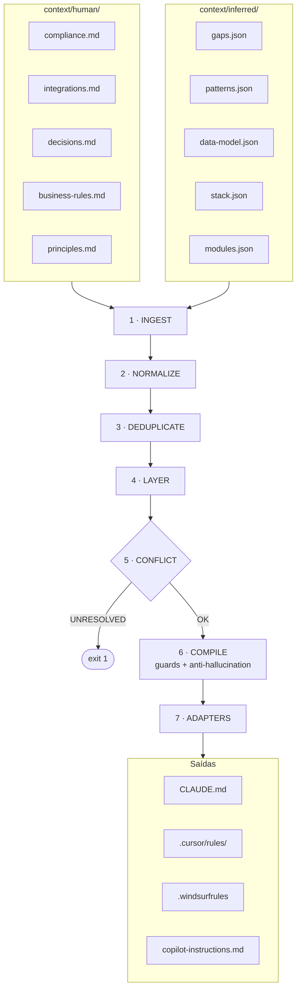

## O que o Pipeline Faz

O pipeline do compilador do MAES transforma dois tipos de entrada — arquivos curados pelo time em `context/human/` e arquivos inferidos por LLM em `context/inferred/` — em um conjunto coerente de regras estruturadas que os assistentes de IA podem consumir.

O resultado final fica em `.maes/synthesis/` e inclui guards (regras de aprovação por path), hot context (as regras mais críticas, sempre carregadas), e arquivos de configuração para cada IDE suportada.

O pipeline é **determinístico**: dado o mesmo conjunto de arquivos de entrada, ele sempre produz o mesmo resultado. Não usa LLM em nenhum dos 7 estágios. Isso significa que `maes sync` é rápido, não tem custo de API, e pode rodar em qualquer ambiente sem variáveis de ambiente especiais.

## Diagrama do Pipeline



## Os 7 Estágios em Detalhe

### Estágio 1 — INGEST

O pipeline começa lendo todos os arquivos de entrada disponíveis:

**Arquivos human/\*.md:** cada arquivo Markdown é parseado seção por seção. O parser extrai "assertions brutas" — fragmentos de texto que descrevem uma regra, restrição ou decisão. Cada parágrafo, item de lista e linha de tabela pode se tornar uma ou mais assertions brutas.

**Arquivos inferred/\*.json:** os arquivos JSON gerados pelo agente externo `/maes-analyze` já estão estruturados. O INGEST os lê diretamente e cria assertions brutas a partir de cada entrada:

- `gaps.json` → assertions sobre comportamentos que a IA provavelmente erraria (`ai_likely_mistakes`) e contratos de comportamento esperado (`behavior_contracts`)
- `patterns.json` → padrões recorrentes detectados no codebase
- `data-model.json` → entidades, campos e restrições inferidas do schema
- `stack.json` → tecnologias detectadas e versões
- `modules.json` → módulos, responsabilidades e dependências detectadas

Ao final do INGEST, o pipeline tem um conjunto de assertions brutas não processadas — texto com metadado de origem (qual arquivo, qual seção).

### Estágio 2 — NORMALIZE

Cada assertion bruta é processada e classificada em campos estruturados:

```json
{
  "claim": "Tokens JWT não devem ser armazenados em localStorage",
  "layer": 2,
  "confidence": 0.95,
  "domains": ["auth", "security"],
  "paths": ["src/auth/**", "src/middleware/auth*"],
  "source_file": "compliance.md",
  "source_section": "Segurança"
}
```

- **claim:** a assertion em linguagem natural limpa
- **layer:** qual das 7 layers corresponde (inferido do arquivo fonte — `compliance.md` → layers 1-2, `integrations.md` → layer 3, etc.)
- **confidence:** 0 a 1 — assertions de arquivos human têm confiança alta (0.9+), assertions de inferred têm confiança mais baixa (0.5-0.8)
- **domains:** categorias semânticas identificadas no texto (auth, billing, compliance, etc.)
- **paths:** padrões de caminho de arquivo que a assertion monitora para staleness

### Estágio 3 — DEDUPLICATE

O MAES compara todas as assertions entre si usando similaridade de Jaccard sobre os tokens do campo `claim`. Quando dois claims têm similaridade ≥ 0.85, são considerados duplicatas.

No merge de duplicatas, a regra é: **mantém a assertion de layer mais alta prioridade** (número menor). Se uma assertion em Layer 2 diz "JWT não em localStorage" e uma assertion em Layer 7 (inferred) diz "tokens não devem ir para localStorage", a versão de Layer 2 prevalece — mais a claim de Layer 7 é descartada.

Isso evita que o contexto final tenha repetições que aumentam o consumo de tokens sem acrescentar informação nova.

### Estágio 4 — LAYER

O conjunto deduplicado é ordenado por prioridade de layer. Assertions de Layer 1 ficam no topo. Assertions de Layer 7 ficam no final.

Quando duas assertions de layers distintas cobrem o mesmo domínio mas têm orientações diferentes, a de menor número (maior prioridade) prevalece. A de maior número é marcada com `superseded_by` apontando para a assertion vencedora — ela é mantida nos metadados para rastreabilidade, mas não vai para o output final.

Esse mecanismo é o que garante que compliance sempre sobrescreve qualquer padrão de engenharia contraditório.

### Estágio 5 — CONFLICT

O detector de conflitos busca assertions que se contradizem. Uma contradição é detectada quando duas assertions do conjunto final têm orientações opostas para o mesmo domínio e paths — por exemplo, uma que diz "use soft delete" e outra que diz "delete fisicamente para LGPD".

Dois tipos de resultado:

**RESOLVED:** o conflito existe mas foi resolvido automaticamente pela hierarquia de layers. Por exemplo, Layer 1 diz "delete físico por LGPD" e Layer 6 diz "soft delete sempre". O pipeline resolve em favor de Layer 1 e registra como RESOLVED em `synthesis/conflicts.json`. Nenhuma intervenção humana é necessária.

**UNRESOLVED:** contradição entre assertions da mesma layer, ou entre assertions onde a hierarquia não pode determinar o vencedor. Nesse caso, `maes sync` retorna exit 1 e registra o conflito em `synthesis/conflicts.json` com o ID `CONFLICT-NNN`.

O CI falha até que um humano resolva o conflito. Para ver os detalhes:

```bash
maes explain conflict --id CONFLICT-001
```

Para resolver: editar o arquivo `human/*.md` correspondente para remover a contradição e rodar `maes sync` novamente.

### Estágio 6 — COMPILE

O conjunto de assertions resolvidas é compilado em dois produtos:

**Guards** (`synthesis/guards.json`): regras de aprovação por path de arquivo. Um guard especifica que alterações em determinado path requerem aprovação ou atenção especial. Por exemplo, uma assertion de Layer 1 sobre `audit_log` imutável gera um guard em `src/repositories/audit*` sinalizando que modificações nessa área precisam de revisão de compliance.

**Anti-hallucination** (`synthesis/anti-hallucination.json`): o hot context — as assertions de Layer 1-3 formatadas de maneira compacta para serem carregadas em todo prompt. O compilador garante que o hot context não excede 800 tokens. Se exceder, o estágio falha com uma mensagem indicando quais assertions precisam ser condensadas.

O hot context é crítico: qualquer regra de compliance ou contrato externo que precisa estar presente em cada interação da IA fica aqui. Regras de Layer 4-6 ficam no contexto "warm" (carregado por relevância da task).

### Estágio 7 — ADAPTERS

O último estágio transpila o contexto compilado para o formato específico de cada IDE e assistente de IA suportado:

**CLAUDE.md** — formato de instruções para Claude Code. As assertions são organizadas em seções hierárquicas, com as de Layer 1-3 no início para garantir máxima atenção do modelo.

**.cursor/rules/** — regras para o Cursor. O adapter cria arquivos separados por domínio dentro do diretório de regras do Cursor.

**.windsurfrules** — arquivo único de regras para o Windsurf.

**copilot-instructions.md** — instruções para o GitHub Copilot no formato esperado pela extensão.

O mesmo conjunto de assertions se torna quatro representações diferentes. Isso significa que um time que usa Cursor em desenvolvimento e Claude Code em revisão recebe o mesmo contexto em ambas as ferramentas, sem necessidade de manutenção duplicada.

## Por que maes sync Não Precisa de API Key

Os 7 estágios do pipeline são puramente algorítmicos. Nenhum deles envolve chamada de LLM. A similaridade Jaccard é calculada localmente. A classificação de layer é baseada no arquivo de origem, não em inferência. A detecção de conflitos usa regras determinísticas.

O core CLI do MAES é 100% determinístico e não chama nenhum LLM. A análise por LLM do codebase, a extração de regras e a avaliação de agentes rodam em **agentes externos** (`/maes-analyze`, `/maes-context-add`, `/maes-eval`) instalados por `maes init` no seu cliente de IA — eles usam o provider do próprio cliente, sem variável de ambiente do MAES. O `maes sync` é puramente determinístico.

## Onde Ficam os Resultados

```
.maes/synthesis/
├── assertions.json        ← todas as assertions normalizadas
├── guards.json            ← regras de aprovação por path
├── anti-hallucination.json ← hot context (layers 1-3, ≤800 tokens)
├── conflicts.json         ← conflitos resolvidos e não-resolvidos
└── staleness.json         ← scores de staleness por assertion
```

Esses arquivos são gerados a cada `maes sync` e devem ser commitados no repositório. As IDEs e assistentes de IA os consomem diretamente (via os adapters gerados) ou via o MCP server (`maes serve`).

<Callout type="info">
  Para entender o sistema de layers em detalhe, veja [As 7 Camadas de
  Prioridade](/docs/architecture/context-layer). Para entender como o staleness é
  calculado e monitorado, veja [Governança e
  Staleness](/docs/architecture/governance-layer).
</Callout>
