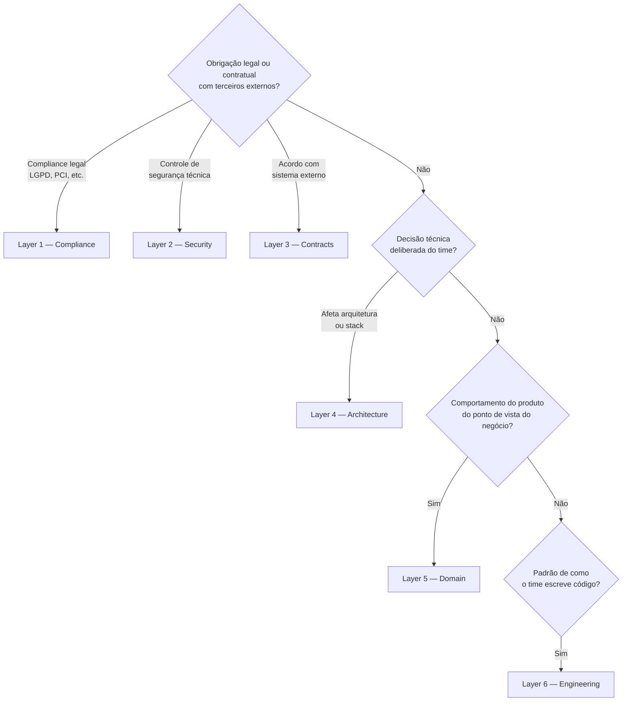

## O Problema de Hierarquia

Imagine dois arquivos de contexto que se contradizem: um princípio de engenharia diz "prefira IDs sequenciais para facilitar debug", enquanto o arquivo de compliance diz "IDs sequenciais em APIs públicas são proibidos por exporem volume de registros". Quando a IA vai gerar código, qual instrução ela deve seguir?

Sem hierarquia definida, a resposta depende da ordem de leitura, do tamanho de cada arquivo ou de um comportamento imprevisível do modelo. Com o sistema de camadas do MAES, a resposta é determinística: **compliance sempre ganha**. Camadas de menor número têm prioridade absoluta sobre camadas de maior número.

Esse princípio vale em todo o pipeline. Durante a fase LAYER do compilador, assertions de Layer 1 sobrescrevem assertions de Layer 7 automaticamente, sem intervenção humana. Conflitos entre layers distintas são resolvidos pela hierarquia. Conflitos dentro da mesma layer (duas assertions contraditórias em Layer 4, por exemplo) são marcados como UNRESOLVED e bloqueiam o CI — porque nesse caso é necessária uma decisão humana.

## As 7 Camadas

| Layer | Nome         | Arquivo fonte                    | Quem é responsável | Exemplos de conteúdo                                                                 |
| ----- | ------------ | -------------------------------- | ------------------ | ------------------------------------------------------------------------------------ |
| 1     | Compliance   | `compliance.md`                  | @security-team     | LGPD, PCI-DSS, log de auditoria imutável, residência de dados                        |
| 2     | Security     | `compliance.md` (seção security) | @security-team     | JWT em httpOnly cookie, CORS restritivo, headers Authorization nunca logados         |
| 3     | Contracts    | `integrations.md`                | @platform-team     | API legada com rate limit 10 rps, campo erp_id nunca removível                       |
| 4     | Architecture | `decisions.md`                   | @tech-leads        | PostgreSQL escolhido sobre MongoDB (DEC-001), UUID gerado pela aplicação (DEC-002)   |
| 5     | Domain       | `business-rules.md`              | @product-team      | Pedido APROVADO não pode voltar para PENDENTE, cancelamento com reembolso automático |
| 6     | Engineering  | `principles.md`                  | @all-engineers     | Commits em inglês, `any` proibido no TypeScript, soft delete com `deleted_at`        |
| 7     | Inferred     | `context/inferred/*.json`        | (gerado por LLM)   | Padrões detectados no código pelo agente externo `/maes-analyze`                     |

### Layer 1 — Compliance

É a camada mais alta de prioridade. Contém obrigações legais e contratuais que não podem ser negociadas. Qualquer assertion nesta camada sobrescreve tudo que estiver em layers inferiores, sem exceção.

Exemplos reais:

- "Dados pessoais de usuários não devem ser logados em nenhuma circunstância" (LGPD Art. 46)
- "Dados de clientes do segmento bancário não podem sair do Brasil" (requisito de residência de dados)
- "O log de auditoria de transações financeiras é imutável — nenhuma operação DELETE ou UPDATE é permitida na tabela `audit_log`"

### Layer 2 — Security

Controles de segurança técnica que não são exigências legais diretas, mas que o time de segurança considera inegociáveis. Na prática, fica na mesma seção do `compliance.md` porque o owner é o mesmo (@security-team) e o nível de rigidez é equivalente.

Exemplos reais:

- "Tokens JWT não devem ser armazenados em localStorage — usar httpOnly cookies"
- "Nunca logar headers de Authorization em produção, nem parcialmente"
- "CORS deve ser restritivo: apenas origens explicitamente listadas no config"

### Layer 3 — Contracts

Acordos com sistemas externos que definem restrições técnicas. Quebrar um contrato pode significar quebrar integração com parceiros ou sistemas legados.

Exemplos reais:

- "API do ERP legado: endpoint /api/erp/sync tem rate limit de 5 rps — sem retry automático"
- "Campo `erp_id` é a chave de join com o ERP — nunca remover nem renomear"
- "Webhook do Stripe deve ser processado com idempotência usando `stripe_payment_id` como chave"

### Layer 4 — Architecture

Decisões arquiteturais documentadas no formato DEC-NNN. Inclui o raciocínio por trás da decisão e as alternativas que foram descartadas — informação crítica para que a IA não sugira exatamente o que o time já avaliou e rejeitou.

Exemplos reais:

- "[DEC-001] PostgreSQL foi escolhido sobre MongoDB porque o modelo de dados é fortemente relacional e ACID é um requisito"
- "[DEC-004] Redis para sessões — descartamos JWT stateless porque precisamos de revogação imediata"

### Layer 5 — Domain

Regras de negócio que definem o comportamento correto do sistema do ponto de vista do produto. A IA pode gerar código tecnicamente correto que viola completamente uma regra de domínio — esta camada existe para prevenir isso.

Exemplos reais:

- "Pedido com status APROVADO não pode ter o status alterado para PENDENTE — essa transição é irreversível"
- "Pedidos com valor acima de R$50.000 requerem aprovação manual de dois membros do time financeiro"
- "CPF deve ser validado com algoritmo de dígito verificador, não apenas com regex de formato"

### Layer 6 — Engineering

Padrões de engenharia definidos pelo time. Diferente das layers superiores, podem mudar com maior frequência conforme o time evolui suas práticas. São os últimos a serem aplicados no pipeline — qualquer regra de compliance ou contrato tem prioridade.

Exemplos reais:

- "Commits em inglês, formato: feat(scope): description"
- "Exports nomeados são preferidos sobre default exports em TypeScript"
- "Soft delete: usar `deleted_at` timestamp — nunca deletar fisicamente"

### Layer 7 — Inferred (Somente Leitura)

Layer 7 é especial: ela não é escrita por humanos. É gerada pelo agente externo `/maes-analyze` — instalado por `maes init` no seu cliente de IA — que usa um LLM para analisar o codebase e extrair padrões implícitos como convenções de nomenclatura, estruturas que se repetem ou padrões de erro.

**Por que Layer 7 é somente leitura?** Porque foi gerada por um LLM, não por uma decisão organizacional. Um padrão detectado no código pode ser uma convenção válida ou pode ser simplesmente o jeito que um desenvolvedor específico escreveu aquele módulo. Layer 7 representa hipóteses sobre o codebase, não verdades organizacionais.

Isso tem uma consequência importante: quando Layer 7 contradiz qualquer layer humana (1-6), a layer humana sempre vence. Nunca edite `context/inferred/` diretamente — esses arquivos são sobrescritos na próxima execução do agente `/maes-analyze`.

## Como as Layers Interagem

O pipeline do compilador aplica as layers em ordem de prioridade:

1. Todas as assertions de todas as layers são coletadas
2. Assertions duplicadas ou similares (Jaccard ≥ 0.85) são mescladas, mantendo a de layer mais alta prioridade
3. Contradições entre layers distintas são resolvidas pela hierarquia: Layer 1 vence
4. Contradições dentro da mesma layer são marcadas como UNRESOLVED e bloqueiam o CI

O resultado final é um conjunto coerente de assertions onde a hierarquia foi respeitada. A IA que consome o contexto compilado recebe um conjunto consistente — nunca duas instruções contraditórias sobre o mesmo tópico.

## Qual Layer Usar?

Use esta árvore de decisão para saber onde colocar uma nova regra:



## Adicionando Contexto em Cada Layer

O agente externo `/maes-context-add` (instalado por `maes init` no seu cliente de IA) extrai regras de texto, arquivos ou docs existentes e roteia automaticamente para o arquivo `human/*.md` correto. Invoque dentro do cliente:

```
/maes-context-add
```

O agente identifica o tipo de cada regra e roteia:

- Regra legal ou de privacidade → `compliance.md` (Layer 1)
- Controle de segurança técnica → `compliance.md` seção security (Layer 2)
- Contrato com API externa → `integrations.md` (Layer 3)
- Decisão arquitetural → `decisions.md` (Layer 4)
- Regra de negócio → `business-rules.md` (Layer 5)
- Padrão de código → `principles.md` (Layer 6)

Para edição direta, os arquivos ficam em `.maes/context/human/`. Após qualquer adição, execute `maes sync` para recompilar o contexto.

<Callout type="warning">
  Nunca edite `.maes/context/inferred/`. Esses arquivos são gerados
  automaticamente pelo agente externo `/maes-analyze` e sobrescritos na próxima
  execução. Edições manuais serão perdidas.
</Callout>

<Callout type="info">
  Para entender como as 7 layers são processadas e transformadas em contexto
  para a IA, veja [Pipeline do Compilador](/docs/architecture/compiler-layer).
  Para entender como o sistema detecta contexto desatualizado, veja [Governança
  e Staleness](/docs/architecture/governance-layer).
</Callout>
