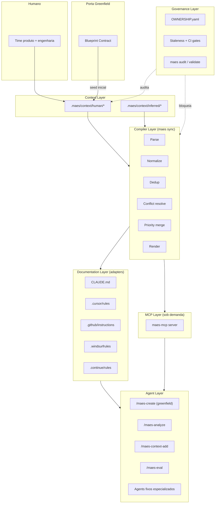

import { Callout } from "fumadocs-ui/components/callout";

MAES não é uma CLI a mais nem um conjunto de prompts. É uma plataforma
organizada em **seis camadas** que cobrem todo o ciclo de Context Engineering
para AI coding agents — da captura do conhecimento humano até a entrega sob
demanda para o agent dentro do IDE.

Cada camada tem uma responsabilidade única, fronteira clara e ferramentas
dedicadas. Entender as camadas é entender o MAES.

## Diagrama de camadas

## 1. Context Layer

**O que é:** a fonte de verdade. Tudo que o agent precisa saber sobre o projeto
mora aqui, versionado no repo.

Subdividida em dois acervos:

- `.maes/context/human/` — conhecimento que **só humano escreve**: compliance,
  decisões arquiteturais (`decisions.md`), contratos com terceiros, restrições
  organizacionais, padrões de revisão de código, runbooks operacionais.
- `.maes/context/inferred/` — conhecimento **detectado automaticamente** pelo
  CLI a partir do código: stack, dependências, módulos, convenções de teste,
  estrutura de pastas. Regenerado a cada `maes sync`.

A separação garante que nunca há ambiguidade entre **o que o time decidiu** e
**o que o código já mostra**.

### Porta Greenfield — o Blueprint

O **Blueprint** não é uma sétima camada: é o **produtor upstream greenfield** do
canal humano. No nascimento de um projeto novo, ele semeia conhecimento
organizacional aprovado em `.maes/context/human/` — e daí em diante o fluxo é o
mesmo de qualquer projeto (Compiler → adapters/MCP).

- **Contrato Inicial de Engenharia**, não scaffolder: a criação usa exclusivamente
  ferramentas oficiais (Official First); o Blueprint só declara stack e semeia
  contexto (ver `docs/adr/0001` e `docs/rfc/0001` no repositório).
- **Context Ownership** (`docs/adr/0003`): após o seed, o **projeto é dono
  permanente** do seu conhecimento. O Blueprint é origem histórica (proveniência),
  **não** dependência de runtime — atualizar o Blueprint da organização **não**
  altera projetos existentes.
- Entra pelo mesmo canal **normativo** (`context/human`); o brownfield (Analyze)
  entra pelo canal **observacional** (`context/inferred`). Os dois convergem só no
  Compiler.

## 2. Compiler Layer

**O que é:** o coração determinístico do MAES — pipeline de sete estágios que
transforma os arquivos da Context Layer em saídas consumíveis por cada cliente
de IA.

Estágios: `parse → normalize → dedup → conflict-resolve → priority-merge →
render → write`. Cada estágio é puro, testado e auditável.

<Callout type="info">
  O Compiler é 100% determinístico — mesma entrada, mesma saída, sem LLM no
  caminho. Isso garante reprodutibilidade em CI e impede "alucinação" no
  contexto entregue ao agent.
</Callout>

Acionado por `maes sync`.

## 3. Agent Layer

**O que é:** os agents de IA que operam **sobre** o contexto. Divididos em duas
classes:

- **Slash commands externos** (instalados por `maes init` no seu cliente):
  - `/maes-create` — cria um projeto greenfield a partir de um Blueprint (porta greenfield)
  - `/maes-analyze` — diagnóstico de gaps na Context Layer
  - `/maes-context-add` — propõe e aplica edições em `human/*.md`
  - `/maes-eval` — avalia qualidade de uma feature/PR contra o contexto
- **Agents fixos especializados** (definidos em `.maes/agents/`): perfis
  reutilizáveis como `arquiteto`, `revisor-seguranca`, `tech-writer` que
  herdam todo o contexto compilado.

A Agent Layer é onde o LLM **finalmente entra em cena** — mas sempre operando
sobre artefatos produzidos pelas camadas determinísticas abaixo.

## 4. Documentation Layer

**O que é:** os **adapters por cliente** que materializam o contexto compilado
no formato nativo de cada ferramenta:

| Cliente          | Artefato gerado          |
| ---------------- | ------------------------ |
| Claude Code      | `CLAUDE.md`              |
| Cursor           | `.cursor/rules/*.mdc`    |
| GitHub Copilot   | `.github/instructions/*` |
| Windsurf Cascade | `.windsurfrules`         |
| Continue         | `.continue/rules/*.md`   |

Toda saída é regenerada por `maes sync`. **Nunca edite à mão** — qualquer mudança
deve ir na Context Layer.

## 5. MCP Layer

**O que é:** o **Model Context Protocol server** (`maes-mcp`) que entrega
contexto **sob demanda** ao agent — em vez de inflar o prompt inicial com tudo.

Útil quando:

- O contexto compilado é grande (monorepo, multi-squad).
- O agent precisa de fatias específicas (apenas `decisions.md`, ou apenas
  contratos de um módulo).
- Você quer que o agent **consulte** o contexto durante a sessão, não apenas
  o receba no início.

Stateless, configurável por cliente, e compatível com qualquer host MCP.

## 6. Governance Layer

**O que é:** as regras, donos e gates que garantem que a Context Layer não
apodrece com o tempo.

Componentes:

- **`.maes/OWNERSHIP.yaml`** — define dono e prazo de revisão para cada
  arquivo de `human/`.
- **Staleness tracking** — `maes audit` reporta arquivos vencidos.
- **CI gates** — workflows que bloqueiam PR quando contexto crítico está
  desatualizado ou quando código diverge das decisões registradas.
- **`maes validate`** — checa consistência estrutural antes de cada sync.

Sem Governance Layer, Context Engineering vira **mais um diretório que ninguém
mantém**. Com ela, vira **infraestrutura**.

## Como as camadas se conectam

1. **Humano escreve** em `human/*.md` (Context).
2. **CLI detecta** stack/módulos em `inferred/*.md` (Context).
3. **`maes sync`** roda o Compiler → gera adapters (Documentation) e atualiza
   o índice MCP.
4. **Agent** abre a sessão no IDE → carrega adapter nativo + consulta MCP sob
   demanda.
5. **Slash commands** (`/maes-analyze`, `/maes-context-add`, `/maes-eval`)
   operam sobre o contexto para diagnosticar, atualizar e validar.
6. **Governance** observa tudo — quem é dono, o que está vencido, o que falta —
   e bloqueia em CI quando necessário.

## Próximos passos

- [`/maes-analyze` e demais agents](/docs/agents/catalog)
- [MCP — entrega sob demanda](/docs/mcp/what-is-mcp)
- [Quick Start](/docs/getting-started/quick-start)
