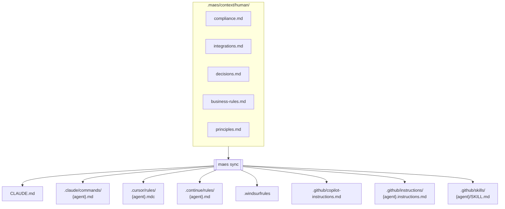

## Uma fonte, múltiplos adapters

O MAES opera como um compilador de contexto: você escreve as regras do projeto uma única vez nos arquivos `human/*.md`, e o comando `maes sync` gera automaticamente um adapter otimizado para cada ferramenta de IA suportada. Isso elimina a necessidade de manter arquivos separados para Claude Code, Cursor, Continue, Windsurf e GitHub Copilot — todos derivam da mesma fonte de verdade.



Quando você atualiza uma regra em `business-rules.md` e executa `maes sync`, todos os adapters são regerados. Nenhum arquivo de integração precisa ser editado manualmente.

## Os adapters e o MCP Server

| Ferramenta     | Arquivos gerados                                                                                                           | Como a ferramenta consome                                     |
| -------------- | -------------------------------------------------------------------------------------------------------------------------- | ------------------------------------------------------------- |
| Claude Code    | `CLAUDE.md` + `.claude/commands/{agent}.md`                                                                                | Carregado automaticamente; commands ativados por `/agent-id`  |
| Cursor         | `.cursor/rules/{agent}.mdc`                                                                                                | Carregado automaticamente como project rule por glob          |
| Continue       | `.continue/rules/maes-context.md` + `.continue/rules/{agent}.md`                                                           | Carregado automaticamente como rules do projeto               |
| Windsurf       | `.windsurfrules`                                                                                                           | Carregado automaticamente em todo contexto                    |
| GitHub Copilot | `.github/copilot-instructions.md` + `.github/instructions/{agent}.instructions.md` + `.github/skills/{agent}/SKILL.md` (¹) | Global sempre ativo; por-agente por glob; skill por argumento |
| MCP Server     | (dinâmico via `maes serve`)                                                                                                | Consultado via Model Context Protocol em runtime              |

(¹) `.github/skills/` é gerado apenas para agents que definem o campo `workflow` no YAML.

O MCP Server é suportado pelo Claude Code, Cursor e GitHub Copilot (VS Code 1.99+). Configure todos os targets de uma vez:

```bash
maes serve --write-mcp-config
# Escreve: .claude/settings.json + .vscode/mcp.json + .cursor/mcp.json
```

## Por que cada adapter é diferente

Mesmo derivando da mesma fonte, os arquivos gerados diferem entre si por razões técnicas:

**CLAUDE.md** inclui o contexto completo estruturado em seções por camada de prioridade (Compliance, Arquitetura, Regras de Negócio, Padrões de Engenharia) além dos guards de path. O Claude Code suporta arquivos longos e lê o CLAUDE.md inteiro antes de cada sessão.

**`.claude/commands/{agent}.md`** são arquivos por agente ativados via `/agent-id` no Claude Code. Cada arquivo carrega o hot context + warm context filtrado por relevância para aquele agente.

**`.cursor/rules/{agent}.mdc`** usa o formato MDC do Cursor, que suporta frontmatter com glob patterns. O Cursor carrega o arquivo correspondente ao path que está sendo editado.

**`.continue/rules/{agent}.md`** usa Markdown com frontmatter para rules do Continue. O MAES gera um arquivo global (`maes-context.md`) com hot context e um arquivo por agent com escopo por glob.

**`.windsurfrules`** segue o formato esperado pelo Windsurf na raiz do projeto — estrutura similar ao CLAUDE.md, sem seções específicas do Claude Code.

**`.github/copilot-instructions.md`** é mais conciso: inclui o hot context (Layers 1-3) em formato compacto para o Copilot Chat global.

**`.github/instructions/{agent}.instructions.md`** são arquivos por agente para o Copilot. O frontmatter `applyTo` define os globs — o VS Code aplica automaticamente o arquivo correto conforme o arquivo editado.

**`.github/skills/{agent}/SKILL.md`** é gerado para agents que definem um `workflow` no YAML. Diferente do `.instructions.md` (persona + regras), o SKILL.md define um workflow faseado com argumentos — por exemplo, `/dev-workflow start` e `/dev-workflow finish`. O Copilot expõe o agent como skill invocável com `@{agent} {argumento}`.

**MCP Server** (`maes serve`) não gera arquivo — expõe as ferramentas `maes_get_agent_context`, `maes_check_guard` e `maes_list_agents` via Model Context Protocol, permitindo que clientes MCP consultem o contexto dinamicamente por tarefa.

## Esses arquivos são gerados — nunca edite diretamente

Os arquivos de adapter são sobrescritos a cada `maes sync`. Qualquer edição manual será perdida na próxima execução.

Para alterar o que aparece nos adapters, edite os arquivos em `.maes/context/human/` e execute:

```bash
maes sync
```

<Callout type="warning">
  Nunca edite os adapters gerados diretamente. Edite `.maes/context/human/*.md`
  e rode `maes sync`.
</Callout>

## Commitar os adapters gerados

Sim — os arquivos gerados devem ser commitados no repositório. Isso garante que todo membro do time tenha acesso ao contexto compilado mesmo sem ter o MAES instalado localmente.

O fluxo recomendado:

```bash
# 1. Editar fonte de verdade
nano .maes/context/human/business-rules.md

# 2. Recompilar
maes sync

# 3. Commitar tudo junto
git add .maes/context/human/ CLAUDE.md .claude/ .cursor/rules/ .continue/rules/ .windsurfrules .github/
git commit -m "docs(maes): atualizar regras de negócio para autenticação"
```

## Atualizar contexto para todas as ferramentas de uma vez

Essa é a vantagem central da arquitetura de adapters: uma única edição se propaga para todas as ferramentas.

Se você precisa adicionar uma nova regra de compliance, edite `compliance.md` e rode `maes sync` — o `CLAUDE.md`, os `.cursor/rules/*.mdc`, os `.continue/rules/*.md`, o `.windsurfrules`, o `copilot-instructions.md` e os `.github/instructions/*.instructions.md` são todos atualizados em sequência.

Para adicionar regras via IA (sem editar manualmente):

```bash
# Use o agente externo /maes-context-add no seu cliente de IA, ou edite
# diretamente .maes/context/human/business-rules.md com a regra:
#   "Todos os endpoints que manipulam PII devem registrar audit log antes de retornar resposta"
```

O MAES analisa o texto, determina a camada correta (neste caso, Layer 1 — Compliance), escreve no arquivo correspondente e você executa `maes sync` para propagar.

## Onde ir a seguir

- Claude Code em detalhe — [Claude Code](/docs/integrations/claude-code)
- Cursor em detalhe — [Cursor](/docs/integrations/cursor)
- Continue em detalhe — [Continue](/docs/integrations/continue)
- GitHub Copilot em detalhe — [Copilot](/docs/integrations/copilot)
- Windsurf em detalhe — [Windsurf](/docs/integrations/windsurf)
- Como usar os agents no dia a dia — [Usando os Agents](/docs/guides/using-agents)
- Medir economia de tokens — `maes explain savings` na [Referência do CLI](/docs/cli/reference)
