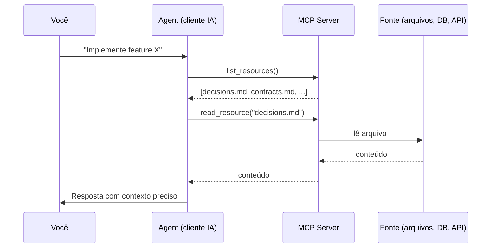

import { Callout } from "fumadocs-ui/components/callout";

**MCP** (Model Context Protocol) é um protocolo aberto criado pela Anthropic
que padroniza **como agents de IA consultam fontes externas de contexto**
durante uma sessão — em vez de receber tudo de uma vez no prompt inicial.

Pense em MCP como o **"USB do contexto"**: qualquer cliente compatível
(Claude Desktop, Claude Code, Cursor, Continue, Windsurf, GitHub Copilot via
extensão) pode se conectar a qualquer servidor MCP e obter dados,
ferramentas e prompts de forma uniforme.

## Como funciona

O servidor MCP expõe três tipos de coisa:

- **Resources** — leitura de dados (arquivos, registros, queries).
- **Tools** — ações que o agent pode executar (rodar comando, criar issue).
- **Prompts** — templates reutilizáveis que o agent pode invocar.

## Por que isso importa para Context Engineering

Sem MCP, você tem duas opções ruins:

1. **Despejar tudo no prompt inicial** → estoura janela de contexto, paga
   tokens caros, mistura o que importa com o que não importa.
2. **Não dar contexto** → agent alucina, ignora decisões arquiteturais,
   reinventa padrões.

Com MCP, o agent **pede o que precisa, quando precisa**.

## MAES + MCP

MAES expõe o contexto compilado como um servidor MCP nativo: `maes-mcp`.

Cada cliente conectado pode:

- Listar todos os arquivos de `.maes/context/` disponíveis.
- Ler decisões, contratos e regras específicas sob demanda.
- Acessar o índice de módulos detectados em `inferred/`.

<Callout type="info">
  MCP é **complementar** aos adapters da Documentation Layer. Os adapters
  (CLAUDE.md, .cursor/rules, etc.) carregam o **essencial** no início da sessão;
  MCP entrega o **resto** sob demanda.
</Callout>

## Próximos passos

- [Por que MCP importa](/docs/mcp/why-mcp-matters)
- [Setup por cliente](/docs/mcp/setup-per-client)
- [As 6 camadas do MAES](/docs/architecture/overview)
